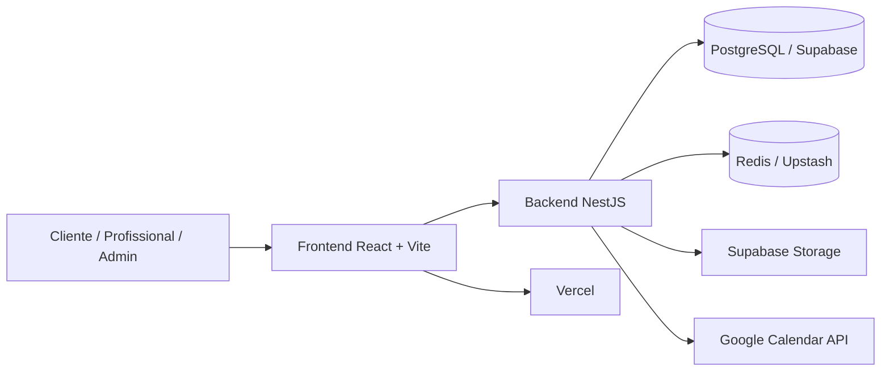

<p align="center">
  <strong>PI-univesp</strong><br />
  Solução web configurável para agendamentos de profissionais autônomos
</p>

<p align="center">
  
  
  
  
  
  
  
  
</p>

> [!WARNING]
> **Projeto acadêmico em desenvolvimento.**
>
> Os códigos OTP são exibidos em modal para demonstração. Não use esta versão com dados reais.
> A integração com o Google Agenda é unidirecional, e os provedores de e-mail e WhatsApp ainda estão em avaliação.

## Demonstração

| Marca             | Link                                           |
| ----------------- | ---------------------------------------------- |
| Dayane — estética | https://dayane-di-giovanni-estetica.vercel.app |
| Karina — salão    | https://karina-alexitsch-estudio.vercel.app    |

Contas de demonstração para os dois ambientes:

| Papel          | Telefone      |
| -------------- | ------------- |
| Admin          | `11999990001` |
| Profissional 1 | `11999990002` |
| Profissional 2 | `11999990003` |
| Profissional 3 | `11999990004` |
| Cliente 1      | `11999990005` |
| Cliente 2      | `11999990006` |
| Cliente 3      | `11999990007` |
| Cliente 4      | `11999990008` |
| Cliente 5      | `11999990009` |
| Cliente 6      | `11999990010` |

Na tela de login, os atalhos de Admin, Profissional e Cliente preenchem o telefone. Depois, clique em **Solicitar código**, copie o código exibido no modal e entre.

## Resumo executivo

O PI-univesp é uma aplicação web configurável para profissionais autônomos de estética e beleza. A mesma base de código atende diferentes marcas, com conteúdo, identidade visual, catálogo, agenda e banco de dados isolados.

O projeto foi desenvolvido como Projeto Integrador da UNIVESP, a partir da escuta de duas profissionais: uma esteticista e uma cabeleireira que também atua com manicure e psicologia clínica.

A solução reúne:

- site público configurável;
- autenticação sem senha por OTP;
- perfis de cliente, profissional e administrador;
- catálogo de procedimentos por profissional;
- disponibilidade semanal, exceções e bloqueios;
- agendamento pelo cliente e pela administração;
- gestão de clientes e histórico;
- documentos POP;
- personalização de marca e galeria;
- sincronização unidirecional com o Google Agenda;
- arquitetura multi-site para Dayane e Karina.

O sistema está em desenvolvimento e ainda não deve ser tratado como pronto para operação real. As limitações conhecidas estão documentadas em [docs/reference/known-issues.md](docs/reference/known-issues.md).

## Screenshots

[IMAGEM: banner principal]

[IMAGEM: landing Dayane]

[IMAGEM: landing Karina]

[IMAGEM: fluxo de agendamento do cliente]

[IMAGEM: agenda administrativa]

[IMAGEM: tela de disponibilidade]

[IMAGEM: modal de código OTP]

[IMAGEM: diagrama de arquitetura]

## Funcionalidades

### Site público

- Landing page configurável por marca.
- Procedimentos exibidos em modal.
- Download público de POPs.
- Contato por WhatsApp, Instagram, telefone e e-mail.
- Mapa e rotas.
- Redirecionamento das rotas antigas para âncoras.

### Cliente

- Cadastro com confirmação de e-mail e telefone.
- Login por telefone e código OTP.
- Recuperação de conta em etapas.
- Visualização dos próprios agendamentos.
- Novo agendamento com procedimento, data, horário e profissional.
- Edição do próprio perfil e contatos.

### Profissional

- Agenda própria.
- Clientes atendidos e histórico.
- Disponibilidade e exceções da própria agenda.
- Procedimentos vinculados ao seu perfil.
- Edição do próprio perfil.

### Administração

- Gestão de clientes, profissionais e equipe.
- Gestão de procedimentos, categorias e POPs.
- Gestão de disponibilidade de qualquer profissional.
- Agenda completa e gestão de agendamentos.
- Personalização de marca, logo, cores, textos e galeria.
- Conexão e sincronização com Google Agenda.
- Controle de acesso por perfil.

## Arquitetura



A aplicação usa dois frontends e dois backends na Vercel, dois bancos no Supabase e um único Upstash compartilhado com prefixo `SITE_ID`.

## Stack

- Frontend: React, Vite, TypeScript, React Router, Tailwind CSS, Radix/shadcn-style, lucide-react, sonner.
- Backend: NestJS, TypeScript, Sequelize, PostgreSQL, Redis, JWT, class-validator, Swagger.
- Banco: PostgreSQL no Supabase.
- Cache e sessões: Redis no Upstash.
- Storage: Supabase Storage.
- Integração: Google Calendar API com OAuth 2.0.
- Deploy: Vercel.

> Mantine e MUI não fazem parte da UI em execução. MUI/Emotion ainda aparecem no `package.json`, mas estão sem uso e são uma pendência de limpeza.

## Estrutura do repositório

| Caminho     | Conteúdo                                             |
| ----------- | ---------------------------------------------------- |
| `backend/`  | API NestJS, migrações, seeds e testes                |
| `frontend/` | Aplicação React/Vite, variantes e testes             |
| `docs/`     | Arquitetura, operações, referência e desenvolvimento |

## Quickstart local

Pré-requisitos:

- Node.js 22 ou superior;
- npm;
- Docker e Docker Compose;
- Git.

### Backend

```bash
cd backend
cp .env.example .env.dev
npm ci
docker compose --env-file=.env.dev up postgres-service redis-service -d
npm run start:dev
```

A API fica em `http://localhost:3000`. O Swagger fica em `http://localhost:3000/documentation`.

> O `.env.example` contém placeholders. Substitua as credenciais e gere `GOOGLE_TOKEN_ENCRYPTION_KEY` com 64 caracteres hexadecimais antes de iniciar o backend.

Para carregar o dataset de demonstração local, com o schema já criado:

```bash
cd backend
SITE_ID=dayane DB_NAME=univesp NODE_ENV=dev npm run seed:demo
```

### Frontend

```bash
cd frontend
cp .env.example .env.local
npm ci
npm run dev
```

O frontend fica em `http://localhost:5173`.

## Variáveis de ambiente

Os arquivos de referência são:

- `backend/.env.example`
- `backend/.env.test.example`
- `frontend/.env.example`

Principais grupos:

- banco: `DB_*`, `DB_SSL`, `DB_SSL_CA_BASE64`;
- Redis: `REDIS_*` ou `REDIS_URL`;
- Upstash REST: `UPSTASH_REDIS_REST_URL`, `UPSTASH_REDIS_REST_TOKEN`;
- autenticação: `JWT_SECRET`, `SITE_ID`, `AUTH_THROTTLE_*`;
- Google: `GOOGLE_*`;
- Supabase Storage: `SUPABASE_*`;
- CORS e proxy: `CORS_ORIGINS`, `TRUST_PROXY`;
- frontend: `VITE_API_BASE_URL`, `VITE_API_PROXY_TARGET`, `VITE_CLIENTE`.

Referência completa: [docs/reference/configuration.md](docs/reference/configuration.md).

## Banco e migrações

O ambiente local usa `DB_SYNC=true` para criar o schema. Em produção, `DB_SYNC` deve permanecer `false`.

O projeto ainda usa scripts de migração ad-hoc, sem ledger versionado e sem rollback automático. A ordem atual e as limitações estão em [docs/operations/migrations.md](docs/operations/migrations.md).

## Testes

```bash
cd backend
npm test
npm run test:e2e

cd ../frontend
npm test
npm run variants:validate
npm run build
```

Estado atual:

- Backend: 32 testes unitários.
- Backend: 52 testes e2e.
- Frontend: 146 testes.
- Builds e Prettier funcionando.
- CI e branch protection ainda não implementados.

## Deploy

Infraestrutura atual:

- Vercel para frontend e backend;
- Supabase para PostgreSQL e Storage;
- Upstash para Redis;
- Google Cloud para OAuth;
- GitHub como repositório central.

Detalhes em [docs/operations/deployment.md](docs/operations/deployment.md).

## Multi-site

O projeto atende Dayane e Karina com:

- domínios e frontends separados;
- backends separados;
- bancos Supabase separados;
- Upstash compartilhado;
- chaves Redis prefixadas por `SITE_ID`;
- variantes de configuração por domínio.

Detalhes em [docs/architecture/multi-site.md](docs/architecture/multi-site.md).

## Modo demonstração

- O backend retorna `demo_code` nos endpoints que geram códigos.
- O frontend exibe o código em modal com botão de copiar.
- Senhas não existem.
- O envio real de OTP ainda não foi implementado.
- O modo demo não possui flag de ambiente nesta versão.
- Qualquer pessoa com o telefone de uma conta demo pode entrar.

Detalhes e contas em [docs/reference/demo-mode.md](docs/reference/demo-mode.md).

## Limitações conhecidas

Os principais pontos em aberto são:

- `demo_code` sempre habilitado;
- telefone desconhecido retorna 404 e permite enumeração;
- CORS sem `PUT`, afetando a atualização de marca;
- admin sem vínculo profissional não acessa disponibilidade;
- backend de horários sem proteção administrativa completa;
- slots de disponibilidade não respeitam a duração total do procedimento;
- ausência de CI, typecheck no frontend e branch protection;
- migrações sem ledger e sem rollback;
- dependências não utilizadas no frontend;
- galeria vazia reidratando imagens padrão;
- health check raso e ausência de métricas/request ID.

Lista completa com severidade, impacto e status: [docs/reference/known-issues.md](docs/reference/known-issues.md).

## Roadmap e decisões em avaliação

- envio real de OTP por e-mail;
- envio real de OTP e lembretes por WhatsApp;
- API oficial da Meta/WhatsApp Cloud API: em avaliação, sujeita a verificação empresarial e custo por mensagem;
- e-mail: SendGrid foi considerado inicialmente e Brevo passou a ser avaliado posteriormente; nenhum provedor foi implementado;
- sincronização bidirecional com Google Agenda;
- CI e branch protection;
- migrações versionadas;
- observabilidade, backups e restauração;
- redução de dependências e code splitting;
- uso real com acompanhamento das profissionais.

## Documentação

- [Índice da documentação](docs/README.md)
- [Primeiros passos](docs/getting-started.md)
- [Arquitetura](docs/architecture/overview.md)
- [Operações](docs/operations/deployment.md)
- [Referência](docs/reference/api.md)
- [Desenvolvimento](docs/development/local-setup.md)

## Agradecimentos

Agradecemos à UNIVESP, ao corpo docente e aos orientadores [NOME DO ORIENTADOR 1] e [NOME DO ORIENTADOR 2]. Agradecemos também à comunidade externa, Dayane Di Giovanni e Karina Alexitsch, pela participação e pelos retornos durante o projeto, e a todos os integrantes do Grupo 9 pelo desenvolvimento da solução.
