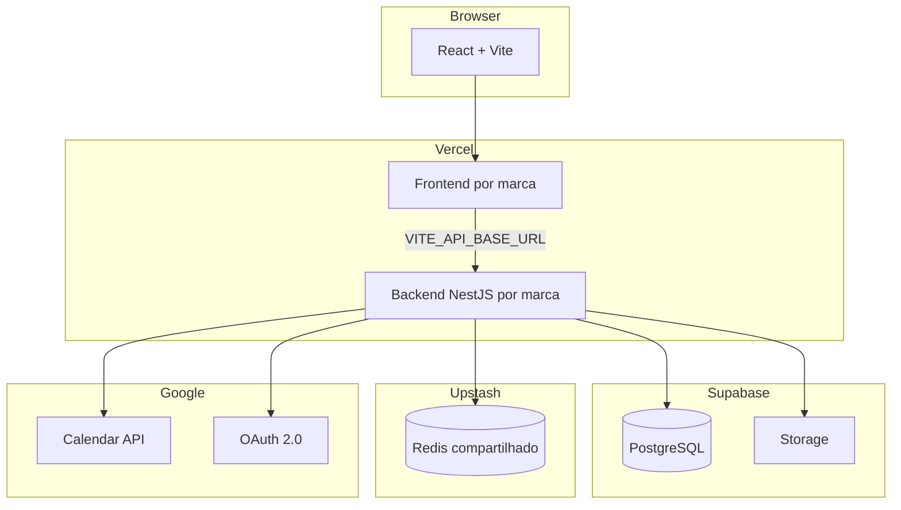

# Arquitetura — visão geral

## Contexto

O sistema é uma aplicação web configurável para profissionais autônomos de estética e beleza. A mesma base de código atende diferentes marcas, com bancos isolados e configuração por domínio.

Instâncias atuais:

- Dayane — estética;
- Karina — salão.

## Componentes



## Backend

Monólito modular NestJS. Módulos principais:

- `auth`: login, cadastro, recuperação e sessão.
- `users`: usuários, clientes, profissionais e contatos.
- `procedures`: catálogo e vínculo com profissionais.
- `categories`: categorias.
- `schedules`: agendamentos, disponibilidade e exceções.
- `pops`: documentos operacionais.
- `site`: marca e galeria.
- `google-calendar`: OAuth e sincronização.

Fluxo típico:

```text
HTTP → Controller → Guard/DTO → Service → Repository/Model → PostgreSQL/Redis
```

Alguns serviços acessam models diretamente. A separação controller/service/repository é predominante, mas não uniforme.

## Frontend

Aplicação React/Vite com:

- configuração de variante resolvida antes do render;
- providers por domínio;
- services centralizados para API;
- rotas por perfil;
- componentes de UI compartilhados sobre Radix;
- Tailwind CSS com variáveis de marca.

O `SiteProvider` seleciona a configuração da marca por domínio ou `VITE_CLIENTE`.

## Persistência

- PostgreSQL no Supabase para dados de negócio.
- Redis no Upstash para OTP, sessões, cache, rate limit e OAuth state.
- Supabase Storage para logo e galeria.
- POPs em Postgres como BLOB.

## Multi-site

Cada marca tem:

- projeto frontend na Vercel;
- projeto backend na Vercel;
- banco Supabase;
- bucket de Storage;
- domínio próprio.

O Upstash é compartilhado. Todas as chaves Redis usam `SITE_ID`.

## Autenticação

- Login por telefone + OTP.
- JWT assinado com `jti`.
- Sessão revogável no Redis.
- Perfis cliente, profissional e admin.
- Autorização por guards e escopo em services.

## Google Calendar

- OAuth 2.0 com escopo `calendar.events`.
- Uma conexão Google por banco.
- Sincronização unidirecional aplicação → Google.
- Eventos criados/atualizados após operações locais.
- Falhas no Google não revertem o agendamento local.

## Deploy

- Vercel para frontend e backend.
- Supabase para banco e Storage.
- Upstash para Redis.
- Google Cloud para OAuth.
- Deploy atual via Vercel CLI, a partir de `main`.

## Princípios atuais

- Configuração por variante, não fork por marca.
- Isolamento de banco por marca.
- Sessão revogável.
- Erros de integração não bloqueiam o fluxo principal.
- Dados públicos separados de operações administrativas.

## Limitações arquiteturais conhecidas

- Sincronização Google síncrona e sem fila.
- Uma única agenda Google por banco.
- Migrações sem ledger/rollback.
- Ausência de CI e typecheck no frontend.
- Dependências não utilizadas.
- Availability com risco de N+1.
- Sem observabilidade estruturada ou backups documentados.

Lista completa: [Known issues](../reference/known-issues.md).
